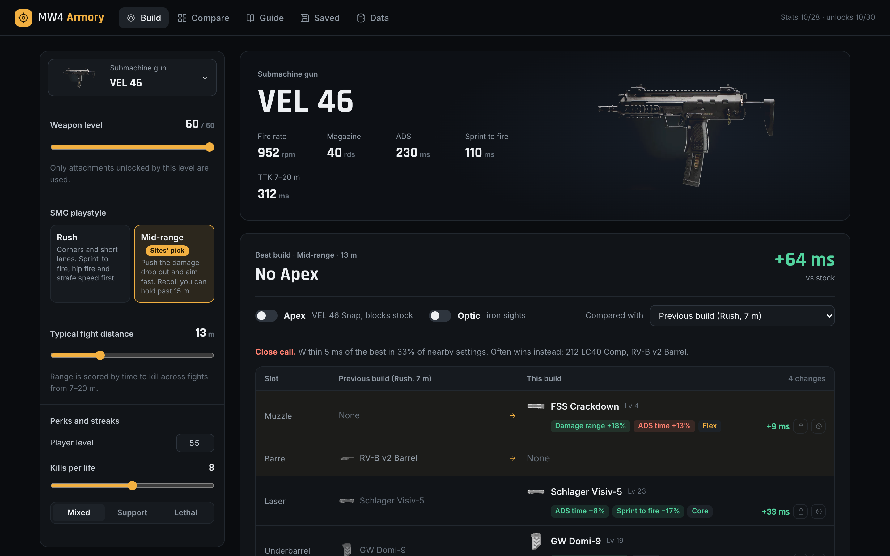
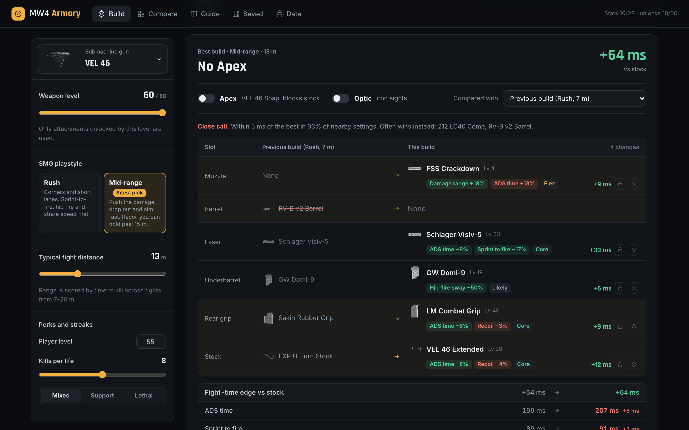
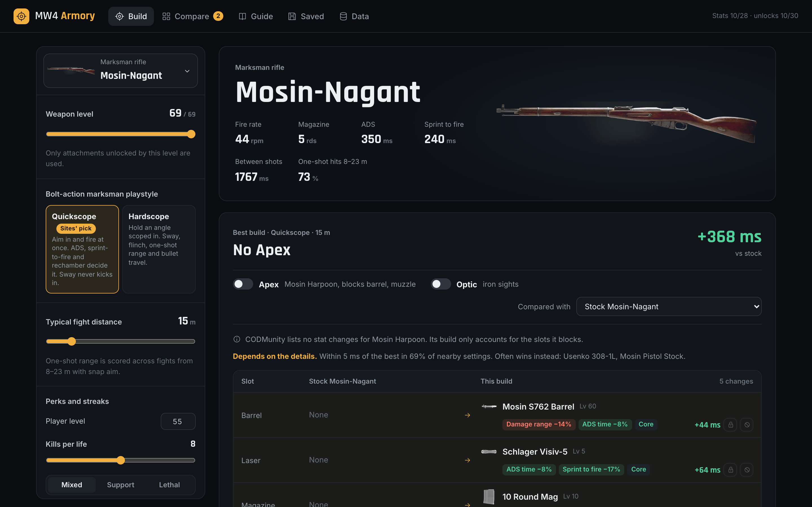
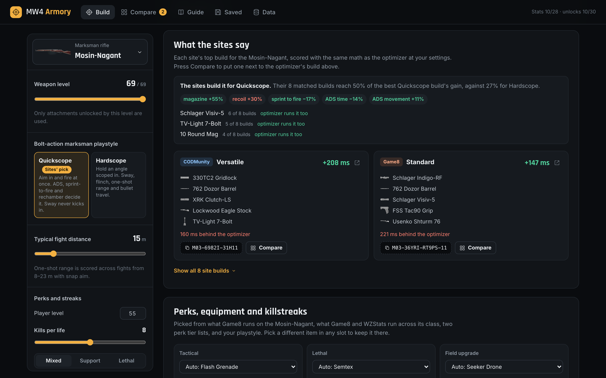
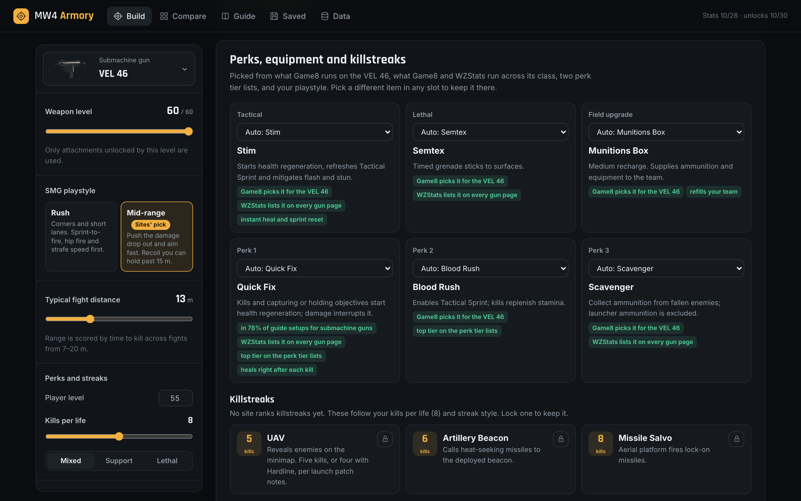
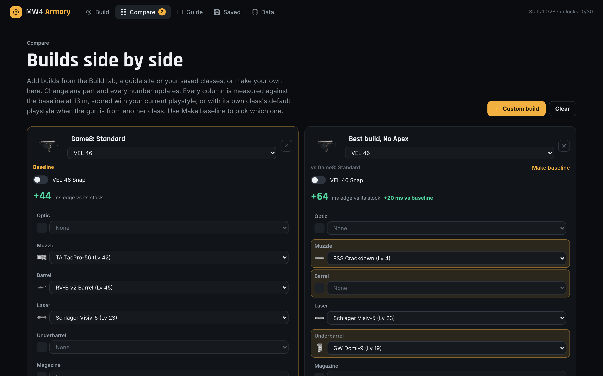
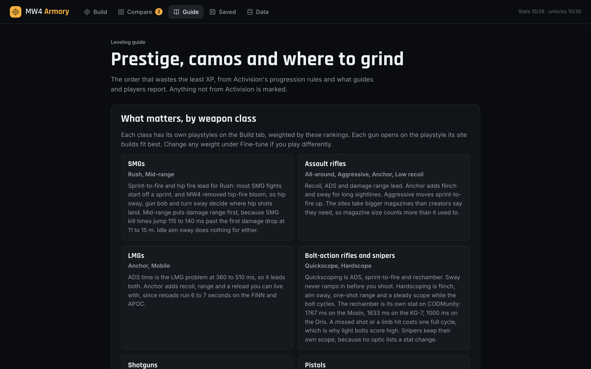
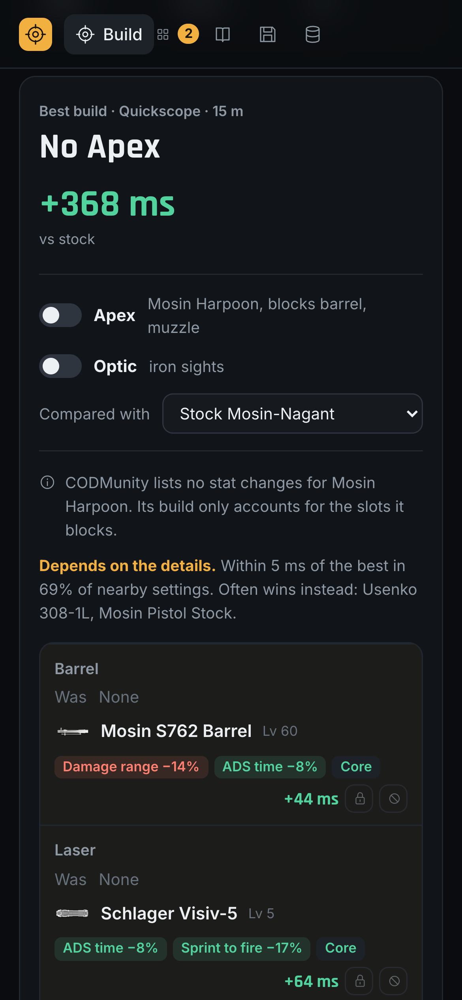

# MW4 Armory

A class optimizer for Call of Duty: Modern Warfare 4 (2026) multiplayer. Pick a gun, a playstyle and your weapon level, and it checks every legal attachment combination against community-measured stats to find the build that wins fights fastest. Each weapon class has its own playstyles, like quickscope and hardscope for snipers or hip fire and slugs for shotguns. It also shows what CODMunity, Game8 and WZStats run on the same gun, scored with the same math, and works out which playstyle those builds are aiming for.



It is a fan project. It is not affiliated with Activision or Infinity Ward, and none of the numbers come from them.

## What it does

### Finds the best build, and shows what changed

Every build is scored in milliseconds of fight time saved against the stock gun. Switch the Apex attachment or an optic on or off right on the build. A "Compared with" picker sets the baseline: by default the build you had before your last change, or the stock gun, the other Apex choice, any site's build, or one of your saved classes. Parts and stats that changed get an arrow. Parts that stayed get none.



### Plays each weapon class its own way

Snipers and bolt-action rifles get Quickscope and Hardscope. Shotguns get Hip fire, Close ADS and Slugs. SMGs, rifles, LMGs and pistols get their own sets. Each playstyle weights the stats its fights turn on, so a quickscope Mosin values ADS, sprint-to-fire and rechamber speed, while a hardscope one values sway, flinch and one-shot range. Snipers keep their own scope, and slug builds always run the slug.



Each part shows its main stat changes, its unlock level, how many milliseconds removing it would cost, and whether it is a core or flex pick. Lock a part to keep it in every build, or exclude it to never see it again.

### Shows what the sites say

Each site's own top build for the gun sits right under the optimizer's pick, with its import code to copy into Gunsmith and how far it lands from the optimizer. Press Compare to load it as the baseline above. 228 site builds across 28 guns are included, 128 with a code.

The site builds are also read for intent. Each one is scored under every playstyle for its class and compared with that playstyle's best build. The playstyle where they come closest is the one the sites are building for: quickscope on the Mosin, KG-7 and Astaroth, hardscope on the Signal 50, slugs on the Warlord. Each gun opens on that playstyle, and the panel lists the stat changes the sites chase and the parts most of them share.



### Fills in perks, equipment and killstreaks

Each slot is picked from what Game8 runs on that gun, what Game8 and WZStats run across its weapon class, two published perk tier lists, and a short playstyle rule. Every pick lists its reasons, and any slot can be swapped. Killstreaks use the launch kill costs and follow your kills per life and streak style.



### Compares builds side by side

The Compare tab holds up to three builds from any gun. Change any part and every number updates. Pick which column is the baseline, and the others show their differences from it.



### Explains leveling, prestige and the camo grind

A guide covers which stats decide fights, Classic against Regular prestige, when to prestige a gun relative to its camos, and which modes are best for XP. Anything not from Activision is marked.

<p>
  
  
</p>

It works on a phone, saves classes in the browser, and shares settings by link. There is no account and no server. Everything runs on your device.

## How builds are scored

The engine checks every combination of up to five attachments, one per slot, leaving out the slots an Apex blocks. Before searching, it drops any attachment that is worse in every scored stat than another one in the same slot, which cannot change the winner. A test checks the result against a full brute-force search.

Attachment changes multiply, the way CODMunity combines them: a +18% range muzzle with a +28% range barrel gives 1.18 × 1.28 = +51%. The score is milliseconds of fight time saved against the stock gun:

- **Time stats count in real milliseconds.** That covers ADS time, sprint-to-fire, weapon swap and time to kill. Time to kill is averaged over fights from half to one and a half times your typical distance, with range attachments stretching every damage band.
- **One-shot guns are scored by shots to kill.** Bolt actions, semi-autos and pistols draw each hit from a body-part spread set by the playstyle, with a miss rate. A limb hit or a miss costs one full shot interval, so rechamber speed and one-shot range count in milliseconds. A bolt action fires at the slower of its fire rate and its rechamber time, both from CODMunity.
- **Bullet velocity counts as travel time past hitscan range.** Bullets hit instantly inside each gun's hitscan range, 12 to 39 m depending on the gun, so velocity rarely matters before then.
- **Recoil counts as a share of one missed shot.** On an All-around rifle, 1% less recoil saves 3% of a shot interval: 3 ms on the Kastov 762. Recoil above stock is penalized faster than it grows.
- **The rest count as small percent weights.** That covers movement, flinch, hip fire, aim sway, magazine, reload and how steady the scope stays while a bolt cycles.

Each weapon class has two to four playstyles with their own weights, from a research pass over what guides and creators say matters for that class. The weights were then checked against the site builds and moved toward them where the research agreed, which raised magazine size for most classes and flinch for snipers. Sliders under Fine-tune adjust any weight the playstyle uses.

A stability line shows how often the pick stays within 5 ms of the best when your priorities and fight distance are nudged. It rescores the top 1,000 builds 200 times. One-shot guns also add the best builds at the near and far distances, because a few meters can flip a one-shot kill.

Shotguns and the Hyeon Burst are scored on handling, recoil and fire rate only, because the data has no pellet spread, shotgun one-shot range, slug damage or burst delay. Optics have no stat data, so sniper builds keep their own scope.

## Data

| Data | Source | Read |
| --- | --- | --- |
| Base stats and each attachment's stat changes, 28 guns | [CODMunity](https://codmunity.gg/weapon-stats/mw4), via [COD Loadout](https://codloadout.gitlab.io/mw4/data-and-assumptions/) | Oct 28, 2026 |
| Which attachments fit each gun, and their unlock levels | CODMunity weapon pages | Oct 30, 2026 |
| Rechamber time, sway while rechambering, pre-fire delay, hitscan range | CODMunity weapon pages | Oct 30, 2026 |
| Apex attachments and the slots they block | Activision's launch guide | Oct 19, 2026 |
| Site builds, codes and gear picks | CODMunity, [Game8](https://game8.co/games/Call-of-Duty-Modern-Warfare-4/archives/630961), [WZStats](https://wzstats.gg/) | Oct 30, 2026 |
| Killstreak costs | Activision's launch post, via COD Loadout and LFCarry | Oct 19, 2026 |
| Perk tier lists | [GameRant](https://gamerant.com/call-of-duty-modern-warfare-4-cod-mw4-best-perks-tier-list/), [games.gg](https://games.gg/call-of-duty-modern-warfare-4/guides/best-mw4-perks-tier-list/) | Oct 26 and 29, 2026 |

The raw snapshots live in `research/raw/`, and `scripts/build-data.ts` merges them into `src/data/game.json`. Site part names are matched to this project's attachment IDs. Obvious typos match, and anything else is shown crossed out and left out of the score.

Known limits:

- Nothing here was measured in a private match. Treat builds within about 5 ms of each other as a tie.
- Automatic time to kill assumes every bullet hits the chest of a 100-health target. The hit spreads and miss rates for one-shot guns are this project's assumptions.
- 9 of 28 Apex attachments have no published stat changes. Their builds only account for the slots they block.
- No site ranks killstreaks yet, so streak picks follow values this project sets.

The in-app Data page lists every source and gap.

## Run it locally

Use Node 26 or newer.

```bash
npm install
npm run dev
```

| Command | What it does |
| --- | --- |
| `npm run dev` | Starts the site at http://127.0.0.1:5173 |
| `npm test` | Runs 23 engine, data and gear checks |
| `npm run build` | Typechecks and writes the static site to `dist/` |
| `npm run data` | Rebuilds `src/data/game.json` from `research/raw/` and rereads the site builds for intent, in about 45 seconds. Add `-- --verbose` to list every near match and unmatched site part |
| `npm run fetch` | Downloads fresh stat files, unlock tables and rechamber and hitscan stats, rebuilds the data, prints what changed per gun and runs the tests |

`npm run fetch` reads one CODMunity page every 5 seconds, so it takes about 3 minutes. Its requests identify themselves as this tool. If a page fails, that gun keeps its previous data. `npm run fetch -- --skip-levels` keeps the unlock table, and `--skip-pages` skips the CODMunity pages and refreshes only the stat files. Site builds were collected in a browser, so `fetch` does not refresh them.

## Project layout

```
src/
  engine/index.ts      build search, scoring, kill model, stability, scoring any given build
  engine/playstyles.ts playstyles and weights for each weapon class
  engine/consensus.ts  reads which playstyle the site builds fit
  engine/gear.ts       perks, equipment and killstreak picks
  views/               Build, Compare, Guide, Saved and Data screens
  data/game.json       generated game data
scripts/
  build-data.ts        merges research/raw into src/data/game.json
  fetch-sources.ts     refreshes the raw snapshots
research/raw/          source snapshots, as read
public/assets/         weapon renders and attachment icons
tests/                 node:test checks
```

See `VERIFICATION.md` for what has and has not been checked.

## Credits

Stats come from [CODMunity](https://codmunity.gg/), through the data files [COD Loadout](https://codloadout.gitlab.io/) publishes. Site builds are from CODMunity, Game8 and WZStats. Weapon renders and attachment icons are from COD Loadout. The artwork belongs to Activision.

Call of Duty and Modern Warfare are trademarks of Activision Publishing. This project is not endorsed by or affiliated with Activision, Infinity Ward or any of the sites above.
